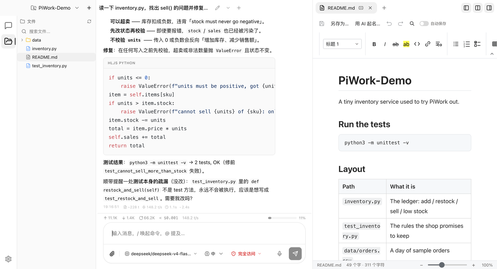

# PiWork-Plugin-Files

[简体中文](README.md) | English

**Official PiWork plugin · File Viewer · `com.pi.files`**

The file viewer in PiWork, and also the editor and generator for Office / PDF documents: click a file in the file tree and it renders in the right panel. The plugin gives the agent a full document toolset too — create, read, and edit docx / pptx / xlsx, run PDF page operations, convert PDF → Office, and export PDF → PNG. Documents are rendered and edited by the bundled GenOffice engine: no Python, LibreOffice, or external Office software required.

## Document processing in PiWork



In the demo below, Markdown and CSV are previewed first, then the agent summarizes by SKU and generates an xlsx report.


## What it does

- **Preview** — docx / pptx / xlsx / pdf, markdown, html, plain text (txt / json / log), images, audio, and video all open directly in the right panel.
- **Manual editing** — the pptx panel supports double-click text editing, fonts, paragraphs, fill, stroke, position, size, rotation, adding and removing elements and slides, inserting tables / charts / SmartArt / images / audio / video / 3D, masters, notes, animations, transitions, undo/redo, find & replace, save-as, and full-screen presentation; docx is edited through the panel's editor as well.
- **Agent create and edit** — the agent creates documents with `office_create`, reads structure with `office_read`, and applies named ops with `office_edit`. A batch is atomic (no half-applied state), with `dryRun` and mtime conflict detection.
- **PDF tools** — merge / split / insert pages / delete pages / crop / resize / N-up; PDF → docx / pptx / xlsx; PDF pages → PNG. All local.
- **Find documents** — when the user only remembers “that quarterly report from last time”, `files_search` matches file name, directory, title, and the opening body text instead of opening files one by one.
- **Completion card** — after a run, one card lists the files created or changed in that run, each with an **Open** button.

## Format coverage

| Format | Panel preview | Agent read / edit | Agent create |
| --- | --- | --- | --- |
| `pptx` | ✅ Konva renderer, manually editable | ✅ full (named ops) | ✅ `office_create` |
| `docx` `docm` | ✅ paginated renderer, editable | ✅ structural edits (open in viewer first) | ✅ `office_create` |
| `xlsx` `xlsm` | ✅ sheet renderer (read-only) | ✅ cell value / clear | ✅ `office_create` |
| `csv` | ✅ sheet renderer (read-only) | ❌ no structural editing | ✅ `office_create` |
| `pdf` | ✅ | body is read-only; page ops via `pdf_edit` | ✅ `office_create` |
| `md` `html` `txt` `json` `log` | ✅ | — | use normal file-write tools |
| Images / audio / video | ✅ | — | — |
| `doc` `ppt` (97-2003) | ✅ text only | ❌ save as docx / pptx first | ❌ |

See [PLUGIN.md](./PLUGIN.md) for the finer details and boundaries.

## Install in PiWork

1. Open the PiWork desktop app.
2. Right panel → **Plugin Center** → **File Viewer** → Install.
3. The first install shows the permission list; after confirmation the package is downloaded and verified (sha256).

The web app does not load plugins; document preview and editing require the desktop app.

Develop from source (heavy dependencies, roughly 800 MB):

```bash
git clone https://github.com/PiWorkAgent/PiWork-Plugin-Files
cd PiWork-Plugin-Files
npm install
npm run build          # backend dist/main.mjs + panel ui-dist/panel
npm run vendor:verify  # verify vendor/genoffice is unmodified
```

Live-reload inside the PiWork repository:

```bash
PI_DEV_PLUGINS=/path/to/PiWork-Plugin-Files pnpm dev:desktop:plugins
```

`vendor/` (GenOffice, Apache-2.0) is a source dependency and is committed; `ui-dist/` is a build artifact and is not.

## Usage in conversation

| You say | What happens |
| --- | --- |
| “Open this contract” | the file tree or `files_open` opens it and it renders in the right panel |
| “Make a quarterly review deck” | the agent calls `office_create` to create a pptx and write content |
| “Change the East China number in this sheet to 4321” | `office_read` locates the cell → `office_edit` changes the value |
| “Merge these three PDFs and export every page as an image” | `pdf_edit` merges → `pdf_render` exports PNGs |
| “Convert this PDF to Word” | `pdf_convert` converts locally, keeping text editable |
| “Where is the file that mentioned the East China budget?” | `files_search` searches titles and body text |

## Tools

| Tool | Purpose |
| --- | --- |
| `office_guide` | Look up op vocabulary, field tables, examples, and common mistakes; call before writing ops |
| `office_read` | Read document structure and return slides / blocks / sheets / cells; element ids are the edit targets |
| `office_edit` | Apply a batch of ops; atomic, with `dryRun` and mtime conflict detection |
| `office_create` | Create pptx / docx / xlsx / pdf / csv, optionally with the first batch of content |
| `pdf_edit` | PDF page ops: merge, split, insert, delete, crop, resize, N-up, insert text |
| `pdf_convert` | PDF → docx / pptx / xlsx, fully local |
| `pdf_render` | PDF pages → PNG |
| `files_search` | Search Office documents and PDFs by name, directory, title, and opening body text |
| `files_open` | Open a file in the viewer (required before structural docx editing) |

## Permissions

| Permission | Purpose |
| --- | --- |
| `filesystem` | Read and write documents the user opens or generates in the workspace |
| `messages` | Post the completion card after a run (files created / changed in the run) |

A plugin backend runs with the same Node process permissions as the user account; the permission declarations limit what the plugin can obtain through the host. The install-time permission confirmation is the user's only real-time line of defense.

## Release

1. Bump `version` in `manifest.json`
2. Commit and push a `v<version>` tag (or Actions → Release → Run workflow)

Release assets: `com.pi.files-<version>.zip` (about 27 MB, runtime payload only) + `index.json`. `vendor/`, `src/`, and `node_modules/` are not included.

## Layout

| Path | Purpose |
| --- | --- |
| `manifest.json` | Plugin manifest: id, version, `apiVersion`, permissions, tools, panels |
| `src/` | Backend / panel source |
| `vendor/genoffice/` | Bundled document engine (upstream source, do not modify, Apache-2.0) |
| `dist/`, `ui-dist/` | Build artifacts (`dist/` committed, `ui-dist/` not committed) |
| `assets/` | Runtime icons |
| `media/` | README demo assets (not shipped in the release) |
| `scripts/release.mjs` | Packaging + single-entry index generation |

## Links

- [PiWork](https://github.com/PiWorkAgent/PiWork) — the host app
- [PiWork-Registry](https://github.com/PiWorkAgent/PiWork-Registry) — marketplace index
- [Plugin development guide](https://github.com/PiWorkAgent/PiWork-Plugin-Docs/blob/main/docs/plugin-dev-guide.md)
- [Plugin SDK `@weiqun789/plugin-sdk`](https://www.npmjs.com/package/@weiqun789/plugin-sdk)
- [PLUGIN.md](./PLUGIN.md) — the agent-facing usage guide
