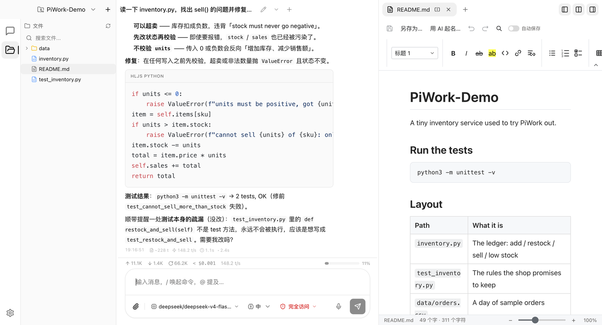

# PiWork-Plugin-Files

PiWork 插件：文件查看器与 Office / PDF 编辑器，内置 GenOffice 引擎。插件 id `com.pi.files`。

> 需要 PiWork 桌面端（Web 端不加载插件）。在 PiWork 的「插件中心」安装；安装、更新、回滚由客户端通过 [PiWork-Registry](https://github.com/PiWorkAgent/PiWork-Registry) 完成。



## 功能

- **右栏预览** — docx / pptx / xlsx / pdf、markdown / html / 纯文本（txt、json、log）、图片、音视频；在文件树里点开即打开。
- **内置引擎** — 文档由 GenOffice 渲染，不依赖 Python、LibreOffice 或本机 Office。
- **编辑 Office / PDF** — pptx 可在面板里直接编辑；docx / xlsx 由 agent 按结构编辑；agent 也能新建 docx / pptx / xlsx / pdf / csv。
- **PDF 页操作** — 合并、拆分、裁剪、插入 / 删除 / 替换页、N-up，PDF → Office 转换，PDF → PNG 导出。
- **文档搜索** — 按文件名、标题和正文摘要在工作区里找文档（「上次那份季度汇报」）。

## 权限

安装时请求：

- `filesystem` — 读取与写入工作区里的文档
- `messages` — 把新建 / 编辑结果作为对话里的卡片回显

## 安装

在 PiWork 里打开插件中心，搜索「文件查看器」并安装。安装、更新、回滚都走真实市场流程（sha256 校验、权限确认、原子替换）。

## 开发

```bash
npm install            # 依赖较重（约 800 MB），首次安装要几分钟
npm run build          # 后端 dist/main.mjs + 面板 ui-dist/panel
npm run vendor:verify  # 校验 vendor/genoffice 未被改动
```

在 PiWork 仓库里实时调试：

```bash
PI_DEV_PLUGINS=/path/to/PiWork-Plugin-Files pnpm dev:desktop:plugins
```

`vendor/`（GenOffice，Apache-2.0）是源码依赖，已提交；`ui-dist/` 是构建产物，不提交。

## 发布

1. 改 `manifest.json` 的 `version`
2. 提交并推送 tag `v<version>`（或 Actions → Release → Run workflow）

Release 资产：`com.pi.files-<version>.zip`（约 27 MB，只含运行时负载）+ `index.json`。`vendor/`、`src/`、`node_modules/` 不进包。

## 目录

| 路径 | 说明 |
| --- | --- |
| `manifest.json` | 插件清单：id、版本、`apiVersion`、权限、工具、面板 |
| `src/` | 后端 / 面板源码 |
| `vendor/genoffice/` | 内置文档引擎（上游源码，勿改） |
| `dist/`、`ui-dist/` | 构建产物（`dist/` 已提交，`ui-dist/` 不提交） |
| `assets/` | 图标与 README 截图 |
| `PLUGIN.md` | 给 agent 的使用说明（随插件一起发布） |
| `scripts/release.mjs` | 打包 + 生成单条目索引 |

## 相关

- 插件开发指南：[PiWork-Plugin-Docs](https://github.com/PiWorkAgent/PiWork-Plugin-Docs/blob/main/docs/plugin-dev-guide.md)
- 后端 SDK：[`@weiqun789/plugin-sdk`](https://www.npmjs.com/package/@weiqun789/plugin-sdk)
- agent 使用说明：[PLUGIN.md](./PLUGIN.md)
